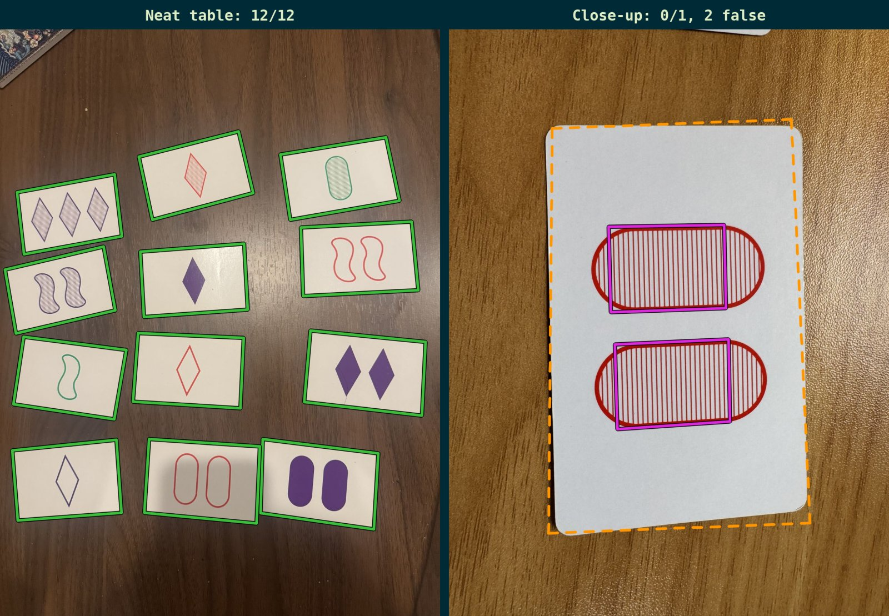
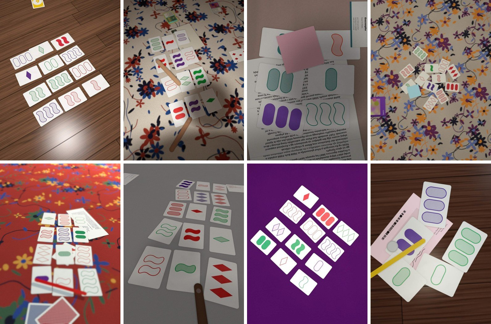
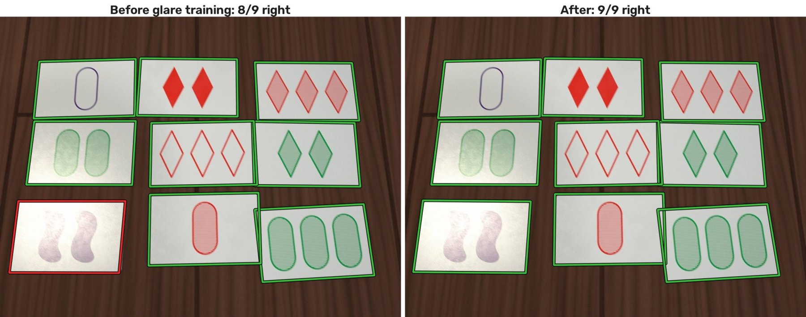
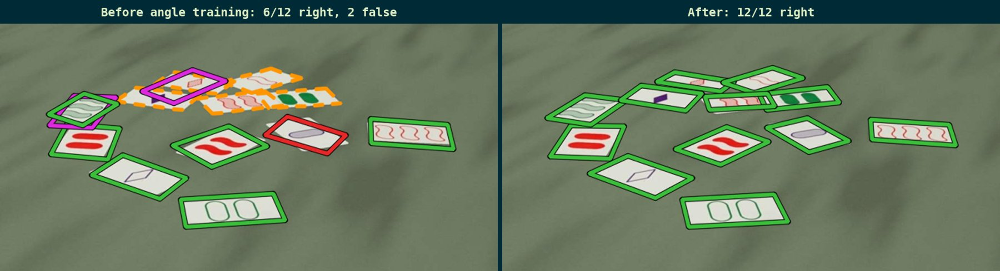
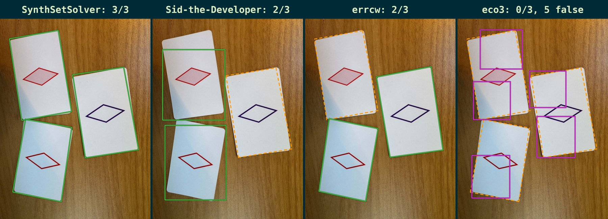
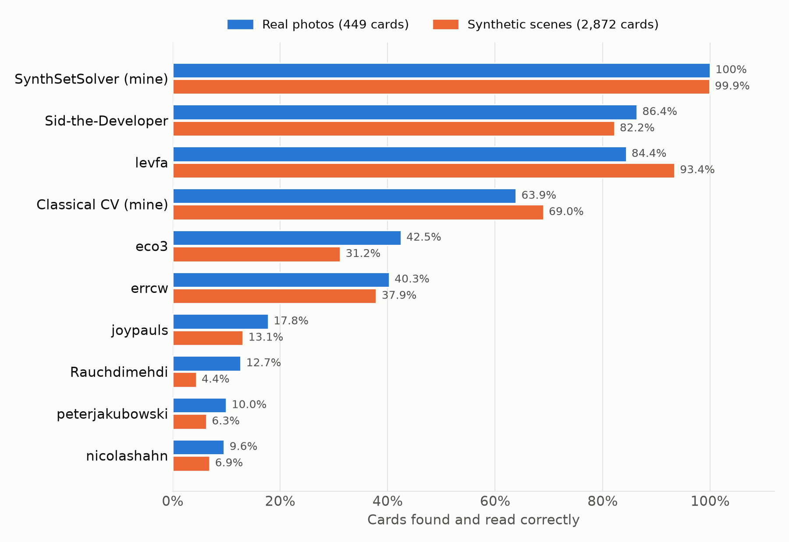

_Solving detection for Set cards with synthetic data_

Github: [https://github.com/makariosc/SynthSetSolver](https://github.com/makariosc/SynthSetSolver)

Try it! [https://makariosc.github.io/setsolver](https://makariosc.github.io/setsolver)

I used Claude to create a synthetic data generator that renders Set cards on different surfaces with lighting glare, shadows, and a variety of augmentations, backgrounds and distractors. The result? A Set detector that works better than any other open-source alternative I could find on the internet.

I once tried creating a Set card detector using classical CV methods. After wasting a week messing around with Otsu thresholding, Canny edge detection, and all manner of pixel value normalizations, I ended up with a half-baked card detector that worked under nominal conditions, but was temperamental and prone to breaking.

_My classical pipeline reads all 12 cards on a neat table (left), but on a close-up of a single card it mistakes the two striped ovals for cards and misses the card itself (right). A green outline indicates a card was read correctly. Dashed orange indicates a missed card, magenta indicates a false detection._
{: .caption}

It eventually became clear that ML would be the most straightforward way to build a detector robust enough to actually deal with real world conditions – that is, something able to detect cards under annoyances such as shadows, overlapping cards, and cluttered dining tables. But gathering (and more importantly, labelling) the thousands of images needed to train a detector would be impossible by myself.

A synthetic scene generator (thank you, Claude) solved all my issues, allowing me to generate 50,000 labeled images in around an hour on my M4 Max Macbook Pro. Not only are the images labeled, but I'm able to create scenes that include the aforementioned shadows, overlapping cards, cluttered dining tables, and other scene augmentations, as well as a variety of card counts and layouts. The data was used to fine-tune an Ultralytics YOLO26n model for card detection, and an EfficientNet-B0 (initialized with ImageNet pretrained weights) for attribute classifications.

_A few generated scenes showing a variety of backgrounds, overlapping cards, clutter, and steep camera angles._
{: .caption}

The flexibility of generating my own scenes quickly paid dividends when, after some testing, I realized that the models were still struggling with glare patches and different camera angles. However, Claude was able to add both of these to the generator quickly, and retraining my model on this new data resulted in improvements to both of these edge cases: the pre-glare model scored 99.1% on the real photo test set (described below), whereas the glare-trained model scored 100%. Likewise, on a synthetic dataset of 150 images rendered from steep angles, accuracy went from 95.6% to 99.4%.

_Before and after adding glare to the generator, on a held-out synthetic scene: the model trained without glare augmentations reads the washed-out solid purple squiggles (bottom left) as striped, whereas the new model reads them all without issue. A green outline indicates a card was read correctly, a red outline indicates a card was misread._
{: .caption}

_Before and after adding steep camera angles, on a held-out synthetic scene shot from a seated player's angle. A green outline indicates a card was read correctly, a red outline indicates a card was misread. Dashed orange indicates a missed card, magenta indicates a false detection._
{: .caption}

## Evaluation and Model Comparisons

Naturally, since the training and testing data are both created from the same scene generator, the pipeline scores 99.9% accuracy on the held-out synthetic data.

However, the model also achieves 100% (!) accuracy on a dataset I put together from real-life photos sourced from myself as well as online. The dataset contains 37 photos, with a total of 449 individual cards in the entire dataset. Two of the photos in this dataset are images of the entire deck laid out on a table. Labels were first proposed by my model and then hand-checked card-by-card so they don't simply favor my model. This dataset includes a variety of scenes with shadows, light glare, and card occlusions. Instructions on recreating this dataset can be found [here](https://github.com/makariosc/SynthSetSolver#test-set).

I also did a search online for a number of other open-source alternatives. Interestingly enough, a model trained completely on rendered data works significantly better on real-life data than the alternatives – even ML alternatives trained on real card images.

_One of my own test photos, read by SynthSetSolver and three of the other detectors. A green outline indicates a card was read correctly. Dashed orange indicates a missed card, magenta indicates a false detection._
{: .caption}

Accuracy here is the share of cards that a detector both finds (its outline overlaps the true card by at least half) and reads correctly on all four attributes. False positives are detections that don't match any card.

| Detector | Method | All real photos, 449 cards (false positives) | Without the two full decks, 287 cards (false positives) |
|---|---|---|---|
| [SynthSetSolver](https://github.com/makariosc/SynthSetSolver) (mine) | ML: YOLO26n-pose corner detector and EfficientNet-B0 reader, trained on rendered scenes | 100% (0) | 100% (0) |
| [Sid-the-Developer/set_solver](https://github.com/Sid-the-Developer/set_solver), 640 px input | ML: one YOLOv8n with 81 classes (one per card) finds and reads cards together | 86.4% (14) | 91.3% (10) |
| [levfa/set-detect](https://github.com/levfa/set-detect) | ML: YOLO11n-pose corner detector and ResNet18 reader, trained on real card cutouts pasted onto textures | 84.4% (0) | 92.3% (0) |
| [Classical CV Pipeline](https://github.com/makariosc/SetChecker) (mine) | Classical CV: thresholding and line-based rectangles, rule-based reader | 63.9% (13) | 76.0% (6) |
| [eco3/set-game](https://github.com/eco3/set-game) | ML: YOLOv8 card detector and MobileNetV3-Small reader | 42.5% (127) | 65.9% (113) |
| [errcw/set-solver](https://github.com/errcw/set-solver) | Classical CV: line segments joined into rectangles, color and contour rules | 40.3% (4) | 62.7% (4) |
| [joypauls/set-game-solver](https://github.com/joypauls/set-game-solver) | Classical CV: brightness threshold, then polygon, color and ink-fraction rules | 17.8% (15) | 23.7% (13) |
| [Rauchdimehdi/smartSetSolverV1](https://github.com/Rauchdimehdi/smartSetSolverV1) | Hybrid: HSV white mask finds cards, Keras CNN with 81 classes reads them | 12.7% (52) | 19.9% (38) |
| [peterjakubowski/SET-Card-Game-Solver](https://github.com/peterjakubowski/SET-Card-Game-Solver) | Classical CV: fixed threshold, template matching for shape, HSV masks for color | 10.0% (27) | 15.7% (15) |
| [nicolashahn/set-solver](https://github.com/nicolashahn/set-solver) | Classical CV: fixed threshold and contours, ORB keypoint matching against templates | 9.6% (26) | 14.6% (23) |

It would be unfair to evaluate detectors only on synthetic data, of course. But comparing the accuracy of each detector on the synthetic scenes to the accuracy of each detector on the real-life images can give us an idea of how similar they are, and the two largely match. This certainly isn't a proof, but it does suggest that the distribution of synthetic data matches real-life data to some degree.

_Share of cards found and read correctly by each detector, on my real test photos and on held-out synthetic scenes._
{: .caption}

## Conclusions

I understand that this isn't much more than a toy example, especially when compared to the recent slew of vibe-mathed solutions to decades-old problems (Set cards are rather distinct, after all, and very regular in appearance). However, the ability to use AI, and AI generated tools, to achieve such results in less than a week on even just a toy example is very encouraging. I'm excited to continue playing with these new tools to see what I can learn with them.
